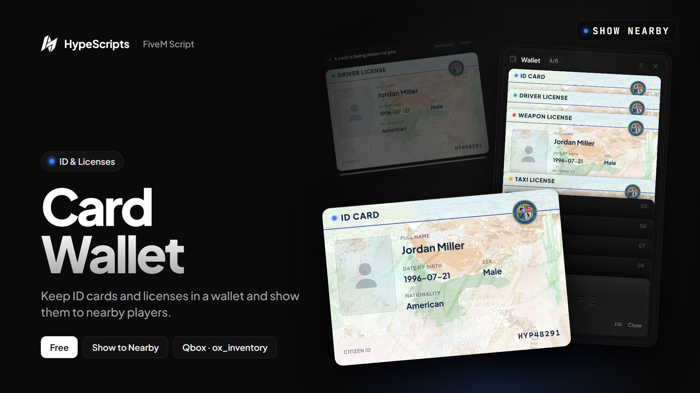
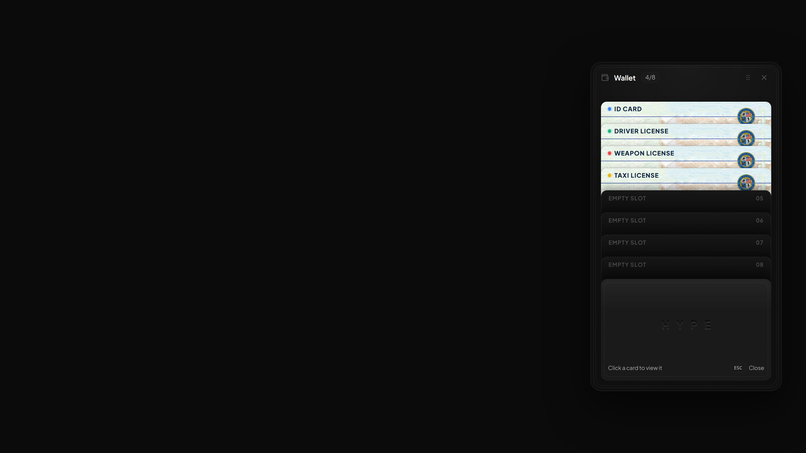
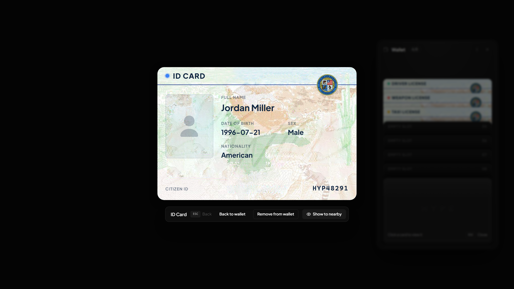
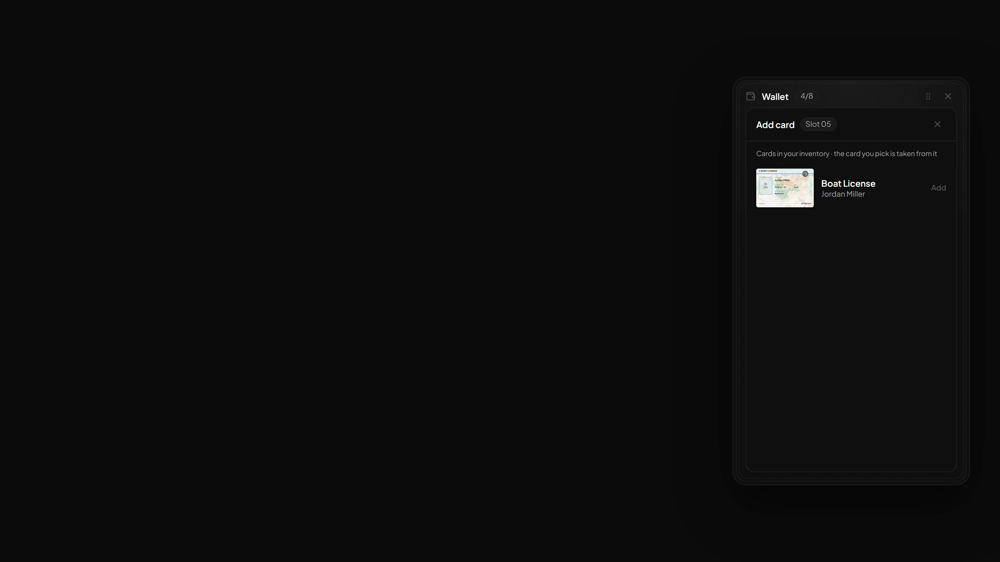
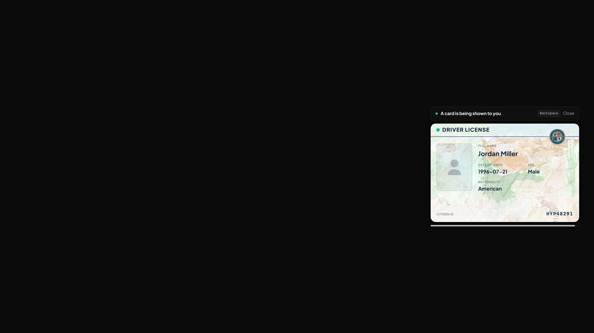
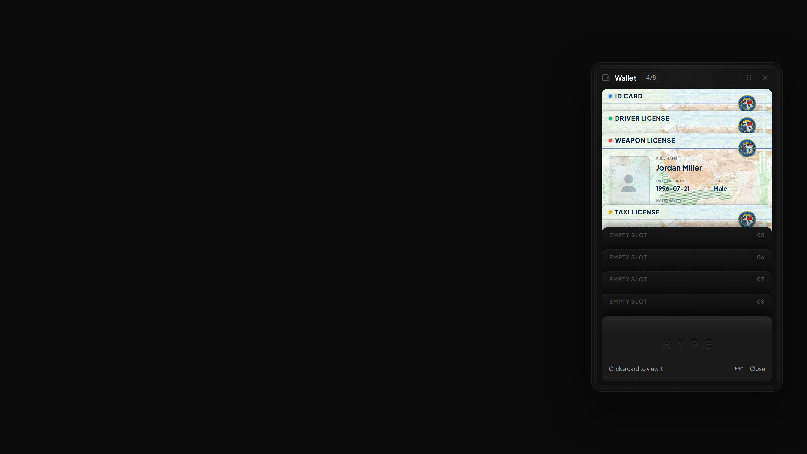

<div align="center">



# hype-wallet

**Card wallet for ID cards and licenses**

A card wallet for Qbox servers by HypeScripts. Players keep their ID card and licenses in a wallet item, look at them full size and show them to the player standing next to them. Cards keep their item metadata, so the name, birth date, citizen ID and photo printed on the card are always the real ones.

The wallet interface is built with Vue 3 and Vite and ships prebuilt in `web/dist`.


[Features](#features) · [Screenshots](#screenshots) · [Installation](#installation) · [Configuration](#configuration) · [Usage](#usage) · [Exports](#exports)

</div>

---

## Features

- **Wallet item**: using the `wallet` item (or the `/cuzdan` command) opens the wallet. Every wallet gets its own ID the first time it is opened, stored in the item's metadata, so the cards stay inside that wallet. Hand the wallet to someone else and the cards go with it.
- **Card slots**: 8 slots by default (configurable). Cards sit in a stack like a real wallet, hovering a card lifts it together with the cards behind it, and empty slots are shown as such.
- **Add cards from the inventory**: click an empty slot to open a picker with every supported card in your inventory. The picked card is removed from the inventory and stored in that slot.
- **Take cards out**: open a card and remove it from the wallet. It goes back to the inventory with all of its metadata. The server checks that the inventory has room first, and puts the card back in the wallet if the inventory refuses it.
- **Card viewer**: click a card to see it full size with the holder's photo, full name, birth date, sex, nationality and citizen ID.
- **Show to nearby**: show the open card to the closest player within 3 metres. The card slides in on their screen without taking their mouse or keyboard focus, with a progress bar, and disappears after 7 seconds or when they press the close key (Backspace by default, rebindable in the FiveM key bindings).
- **Show animation**: the player who shows a card plays an animation holding a card prop (configurable, can be turned off).
- **Card designs**: every card type has its own label, accent colour and optional background image. Cards without a background use the default card image.
- **Mugshots**: a `mugShot` value in the card metadata (a base64 `data:image/...` URL, up to 512 KB) is shown as the card photo. Without one a silhouette is shown.
- **Movable wallet**: drag the wallet by its header anywhere on screen. The position is remembered between sessions, and a double click on the header resets it.
- **Keyboard friendly**: ESC closes the card picker, then the card viewer, then the wallet.
- **Server side validation**: every add, remove and show is checked on the server. The wallet must still be in the player's inventory, the slot and card must exist, the target must be a real player in the same routing bucket and within range, and showing has a cooldown. Actions run one at a time per player and items are removed before they are stored, so cards can't be duplicated.
- **Multi-language**: English and Turkish are included. All texts, including the interface and card names, come from `locales/*.json` through the ox_lib locale module, and adding a language is a single file.
- **License checks for other scripts**: the `HasCardInWallet` export tells you whether a player carries a given card in a wallet, optionally issued to a specific citizen ID.

## Screenshots

<table>
  <tr>
    <td width="50%"></td>
    <td width="50%"></td>
  </tr>
  <tr>
    <td align="center"><sub>The wallet with its card stack</sub></td>
    <td align="center"><sub>Looking at a card full size</sub></td>
  </tr>
  <tr>
    <td></td>
    <td></td>
  </tr>
  <tr>
    <td align="center"><sub>Adding a card from the inventory</sub></td>
    <td align="center"><sub>A card shown by a nearby player</sub></td>
  </tr>
</table>

<details>
<summary><b>More screenshots</b></summary>
<br>

<table>
  <tr>
    <td width="50%"></td>
  </tr>
  <tr>
    <td align="center"><sub>Hovering a card lifts it out of the stack</sub></td>
  </tr>
</table>

</details>

## Requirements

| Resource | Link |
| --- | --- |
| ox_lib | https://github.com/overextended/ox_lib/releases/latest |
| ox_inventory | https://github.com/overextended/ox_inventory/releases/latest |
| qbx_core | https://github.com/Qbox-project/qbx_core/releases/latest |
| OneSync | OneSync enabled (the server reads player positions and routing buckets) |

Only Qbox with ox_inventory is supported. ESX and QBCore are not supported out of the box.

## Installation

1. Put the `hype-wallet` folder in your `resources` directory. Keep the folder name: stored cards live in the resource's KVP storage, which is tied to the resource name.
2. Ensure it after its dependencies in your `server.cfg`:

   ```cfg
   ensure ox_lib
   ensure qbx_core
   ensure ox_inventory
   ensure hype-wallet
   ```

3. Add the items to `ox_inventory/data/items.lua` (see below).
4. Give players a `wallet` item and card items in whatever way your server issues them (city hall, shops, licensing jobs and so on).
5. Restart the server.

`web/dist` already contains the built interface, so you don't need Node.js or pnpm to run the resource. If you got the resource from a git checkout without `web/dist`, build the UI first (see [Rebuilding the UI](#rebuilding-the-ui)).

### Items

Add these to `ox_inventory/data/items.lua`. The names must match `walletItem` and the `item` fields of `cards` in `config/shared.lua`. Labels and weights are only suggestions.

```lua
['wallet'] = {
    label = 'Wallet',
    weight = 100,
    stack = false,
    close = true,
    consume = 0,
},

['card_id'] = { label = 'ID Card', weight = 10, stack = false },
['card_driver_car'] = { label = 'Driver License', weight = 10, stack = false },
['card_driver_motor'] = { label = 'Motorcycle License', weight = 10, stack = false },
['card_driver_boat'] = { label = 'Boat License', weight = 10, stack = false },
['card_driver_plane'] = { label = 'Pilot License', weight = 10, stack = false },
['card_weapon'] = { label = 'Weapon License', weight = 10, stack = false },
['card_taxi'] = { label = 'Taxi License', weight = 10, stack = false },
```

Keep `wallet` non-stackable: each wallet carries its own ID in its metadata, and a stack of blank wallets would end up sharing one ID.

The wallet is registered as a usable item through `qbx_core`'s `CreateUseableItem`, so the item definition doesn't need a `server` or `client` export.

### Card metadata

The wallet reads these metadata fields from each card item. Whatever script hands out the cards should set them:

| Field | Shown as |
| --- | --- |
| `firstname`, `lastname` | Full name |
| `birthdate` | Birth date |
| `sex` | Sex (`M`/`Male` and `F`/`Female` are translated, other values are shown as they are) |
| `nationality` | Nationality |
| `citizenid` | Citizen number |
| `mugShot` | Photo, as a `data:image/...;base64,` URL of up to 512 KB |

Missing fields are shown as a dash. The whole metadata table is stored with the card and given back unchanged when the card is taken out.

## Configuration

Everything is in `config/shared.lua`:

| Option | Default | Description |
| --- | --- | --- |
| `walletItem` | `'wallet'` | Inventory item that opens the wallet |
| `slots` | `8` | Number of card slots in a wallet |
| `command` | `'cuzdan'` | Command that opens the first wallet in the inventory, `false` to disable |
| `defaultBackground` | card image URL | Card background used when a card has no `background` |
| `show.distance` | `3.0` | Maximum distance to the player you show a card to |
| `show.duration` | `7000` | How long a shown card stays on the other player's screen (ms) |
| `show.position` | `'right'` | Side of the screen the shown card appears on: `'right'` or `'left'` |
| `show.cooldown` | `3000` | Wait between two shows (ms) |
| `show.closeKey` | `'BACK'` | Default key to close a shown card early, players can rebind it |
| `show.animation` | card prop animation | `dict`, `clip`, `prop` and `duration` of the show animation, `false` to disable |
| `cards` | 7 card types | Cards the wallet accepts, in slot order |

Each entry in `cards` looks like this:

```lua
{ item = 'card_id', label = 'card.id', accent = '#3b82f6', background = 'https://...' },
```

`item` is the inventory item name and `label` is the name printed on the card: a locale key (`card.*` in `locales/*.json`) or plain text. `accent` is the colour of the dot next to the title and `background` (optional) overrides `defaultBackground`.

## Languages

English (`en`) and Turkish (`tr`) are included in `locales/`. The language follows ox_lib's locale setting, so set it in your `server.cfg`:

```cfg
setr ox:locale "en"
```

English is the base: any key missing from the selected language falls back to `en.json`. If ox_lib lets players pick their own language, the wallet follows that choice too, including the interface.

To add a language, copy `locales/en.json` to `locales/<code>.json` (for example `de.json`), translate the values and set `ox:locale` to that code. Keep the keys and the `%s` placeholders as they are. The `ui` section holds the interface texts, `card` the card names, `notify` the notifications. No UI rebuild is needed for new languages.

## Usage

| Action | How |
| --- | --- |
| Open the wallet | Use the `wallet` item, or type `/cuzdan` |
| Add a card | Click an empty slot and pick a card from the list |
| View a card | Click a card in the stack |
| Take a card out | Open the card and click "Remove from wallet" |
| Show a card | Open the card and click "Show to nearby" |
| Close a card shown to you | Backspace (key binding `hype_wallet_hide_card`, rebindable under Settings > Key Bindings > FiveM) |
| Move the wallet | Drag it by its header, double click the header to reset |
| Go back / close | ESC |

## Exports

### Server

```lua
-- Opens a wallet for a player. `item` is an ox_inventory slot table;
-- without it the first wallet in the player's inventory is opened.
exports['hype-wallet']:OpenWallet(source, item)

-- Whether one of the wallets in the player's inventory holds the card.
-- Pass a citizenid to only count cards issued to that citizen.
local hasLicense = exports['hype-wallet']:HasCardInWallet(source, 'card_weapon')
local ownLicense = exports['hype-wallet']:HasCardInWallet(source, 'card_driver_car', citizenid)
```

### Client

```lua
-- Closes the wallet if it is open
exports['hype-wallet']:CloseWallet()
```

## Events

These are used internally and listed for reference. Every request is validated on the server.

| Event | Side | Purpose |
| --- | --- | --- |
| `hype-wallet:client:open` | Client | Opens the wallet with the payload sent by the server |
| `hype-wallet:client:showCard` | Client | Displays a card another player showed |
| `hype-wallet:client:notify` | Client | Shows a notification from the server, translated into the player's language |
| `hype-wallet:client:cardShown` | Client | Confirms the show to the player who showed the card and plays the animation |
| `hype-wallet:server:showCard` | Server | Shows a card from the open wallet to a nearby player |
| `hype-wallet:server:closed` | Server | The player closed the wallet |
| `hype-wallet:server:addCard` | Server callback | Moves a card from the inventory into a wallet slot |
| `hype-wallet:server:removeCard` | Server callback | Moves a card from a wallet slot back to the inventory |

## Storage

Cards are stored in the resource's KVP storage, one entry per wallet slot (`wallet:<walletId>:<slot>`), so no database table is needed. The wallet ID lives in the wallet item's metadata. Cards stay in their wallet as long as that wallet item exists; deleting the wallet item leaves its cards unreachable.

## Rebuilding the UI

Only needed if you change files in `web/src`. Requires Node.js and pnpm.

```sh
cd web
pnpm install
pnpm build
```

The build is written to `web/dist`, which the resource loads as its `ui_page`.

To work on the interface in a browser, run `pnpm dev` in `web`. Outside FiveM the UI opens in English with mock data from `web/src/mock.ts`, and "show to nearby" previews the receiving side on the same screen. In game the interface asks the client script for the `ui.*` locale texts when it loads and again whenever the language changes; the English fallbacks in `web/src/lib/i18n.ts` are only used outside FiveM or for a missing key.

## License

MIT, see `LICENSE`.

<div align="center">
<sub>Made by <b>HypeScripts</b></sub>
</div>
